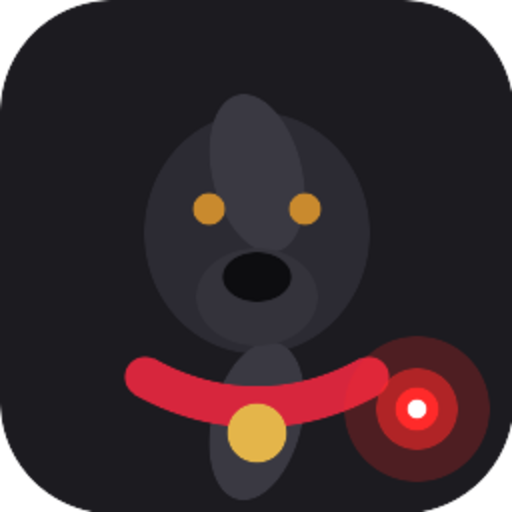
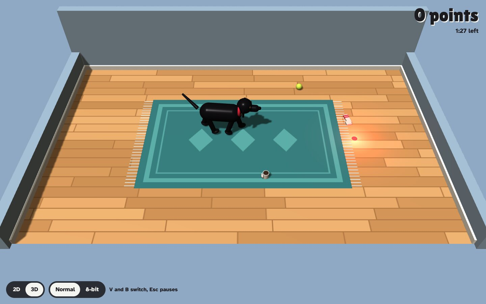
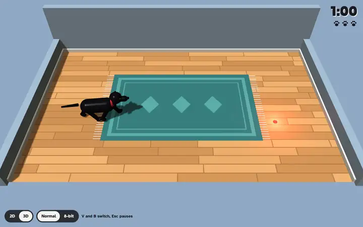
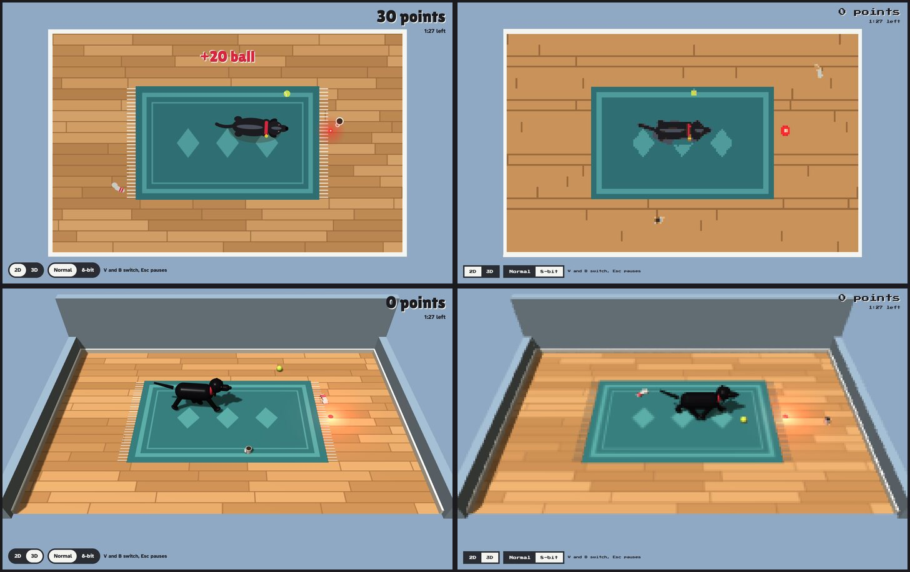
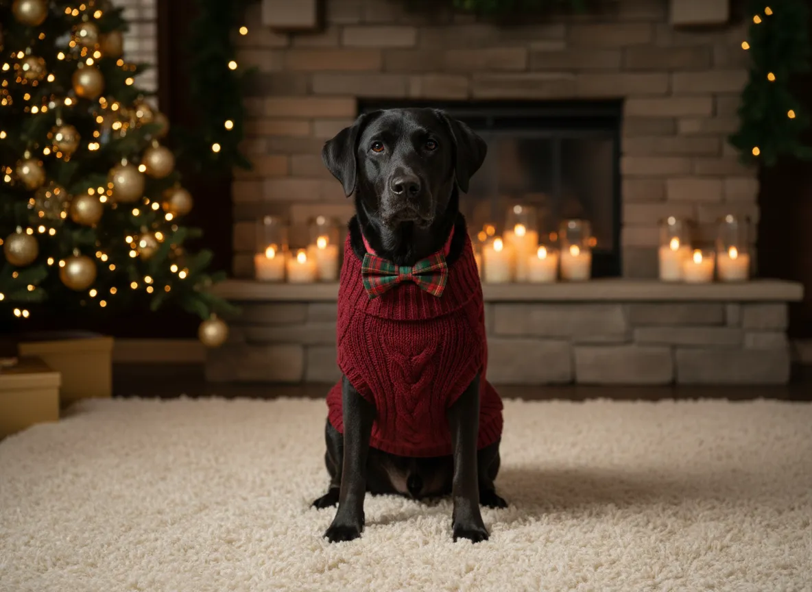
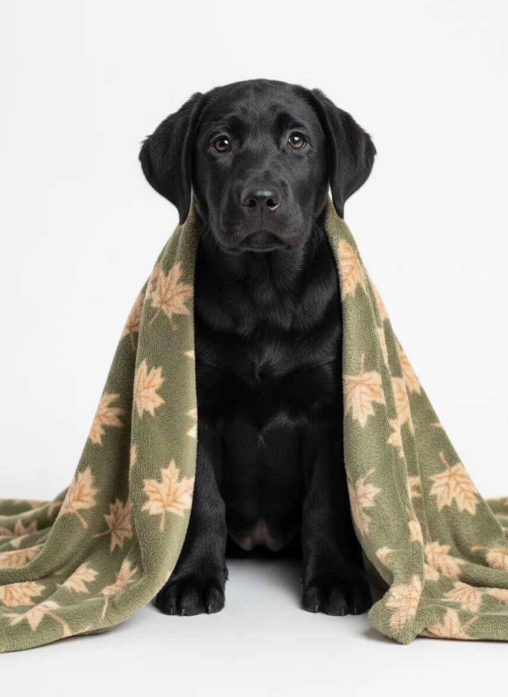

<div align="center">



# Spot-light

**Spot the black labrador chases a laser dot, in 2D, 3D or 8-bit, across three game modes.**

[Playing](#playing) · [Meet Spot](#meet-spot) · [Run it locally](#run-it-locally-step-by-step) · [How it works](#how-it-works) · [Contributing](#contributing)


[](https://github.com/Gitguy268/spot-light/actions/workflows/test.yml)



</div>

Spot is a two-year-old black lab who is sure the red dot is alive. Your mouse is the laser pointer. The whole game is one `index.html` file plus three.js, so it runs offline from a double-click.

Want it to look real? **[Spot-light HD](https://github.com/Gitguy268/spot-light-hd)** is the realistic version, with fur, a furnished room, sound and more modes.

<!-- live-links -->
**Live:** [gitguy268.github.io/spot-light](https://gitguy268.github.io/spot-light/) · [spot-light-pi.vercel.app](https://spot-light-pi.vercel.app)
<!-- /live-links -->

<!-- run-steps:start -->
## Run it locally, step by step

1. **Get the code:**

   ```sh
   git clone https://github.com/Gitguy268/spot-light.git
   cd spot-light
   ```

2. **Open `index.html`** by double-clicking it. There is nothing to install or build.
<!-- run-steps:end -->

## Playing



Move the mouse (or hold the arrow keys) to steer the dot. Spot runs after it, and when he gets close he pounces.

| Mode | Goal |
|---|---|
| **Dodge** | 60 seconds and 3 lives. Keep the dot out of his paws. |
| **Endless** | No clock. Count how often he gets it, and your longest dodge streak. |
| **Lure** | Steer him into the cup, the sock and the ball to knock them over for points. |

| Key | What it does |
|---|---|
| Mouse or arrow keys | move the laser dot |
| `V` | switch between 2D and 3D |
| `B` | switch between Normal and 8-bit |
| `Esc` | pause |

<p align="center"></p>

The 8-bit style draws the scene at one fifth of the resolution. In 2D it also snaps every pixel to a 16-colour palette.

## Meet Spot

Spot is the author's real dog: a black labrador, two years old, with a red collar. These portraits are AI-generated images of him.

<p align="center">
  
  
  
</p>

## How it works

<details>
<summary><b>Spot's brain, views and self-checks</b></summary>

- **One file.** All CSS and JavaScript is inline in `index.html`. three.js r149 is the last classic (non-module) build, so the page works from `file://` without a server.
- **Spot's brain.** A small state machine: chase, crouch (with a butt wiggle), pounce at where the dot was, land. He turns at a limited rate and slows down when he isn't facing the dot. His paws must land within 42 cm of the dot to count as a catch. If the dot stays still for a while, he gets bored and sits.
- **Two views of one room.** The game state lives in room coordinates (metres). The 2D view maps them to a top-down canvas; the 3D view builds the room, Spot and the items from three.js primitives and projects the mouse onto the floor with a raycast.
- **Self-checks.** On load, `console.assert` checks that Spot moves towards the dot, that pounces catch and miss correctly, and that the 2D mouse mapping round-trips.
- **No tracking.** The page makes no requests besides Google Fonts and stores nothing.

</details>

<details>
<summary><b>Tests and pictures</b></summary>

```sh
npm ci
npx playwright install chromium
npm test          # every mode x view x style from file://, fails on console errors
npm run capture   # regenerates docs/screenshot.jpg, views.jpg, title.jpg and demo.webp
```

`npm run capture` uses the GPU (`--use-angle=metal`) and needs ImageMagick and `img2webp`. CI runs `npm test` in SwiftShader on every push.

</details>

## Contributing

Issues and pull requests are welcome, see [CONTRIBUTING.md](CONTRIBUTING.md). Please keep the game a single file that runs from a double-click, and run `npm test` before opening a pull request.

## Licence

MIT, see [LICENSE](LICENSE). three.js and the fonts keep their own licences, and the portraits of Spot are not covered by the MIT licence. See [NOTICE](NOTICE).
